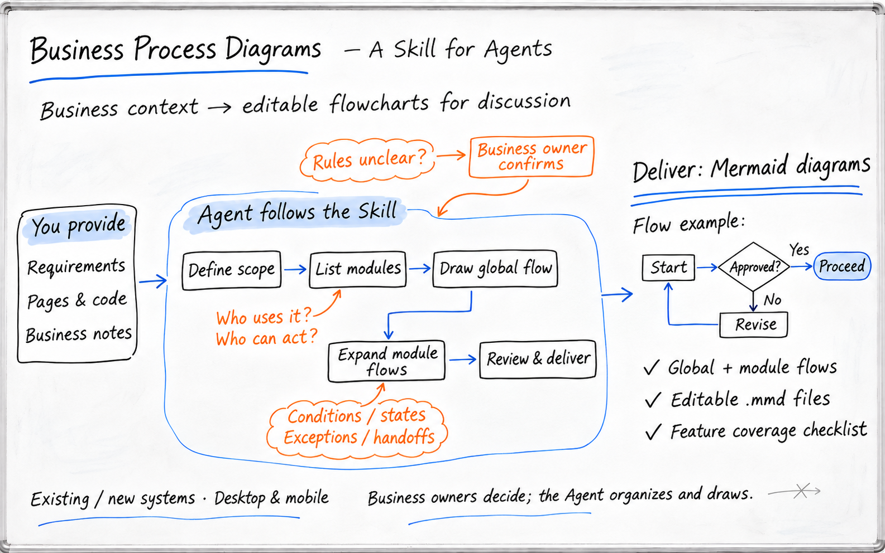
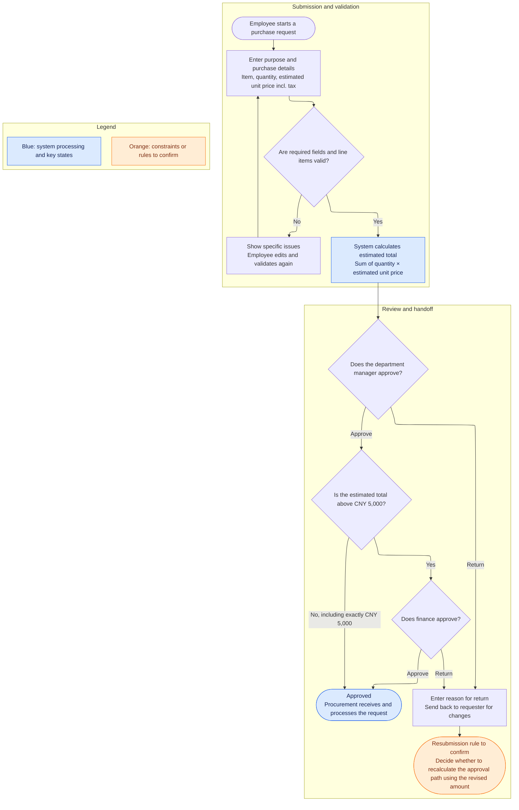

# Business Process Diagrams

[简体中文](README.md) | English

> The Skill instructions and diagramming standards are currently written in Chinese.

**Business Process Diagramming**

[View the skill](skills/business-process-diagrams/SKILL.md) · [Diagramming standards](skills/business-process-diagrams/references/mermaid-standard.md)



*Illustration of how the skill works, AI-generated.*

This skill guides an Agent to organize business explanations, requirements, and system materials into a Mermaid diagram set from a product manager's perspective.

It first identifies the business modules, draws an end-to-end overview, and then expands each module into a complete flow. The diagrams make clear who handles each step, how the system evaluates conditions, how states change, and who receives work when something goes wrong.

Use it to map PC and mobile business processes or design a new system.

## Why this skill exists

Business reviews often raise practical questions: Who provisions a resource after approval? Which permissions should be removed when an employee leaves a project? Who handles the part of an operation that only partly succeeded?

These questions affect product requirements, permissions, and acceptance. Mapping the flow helps teams discuss them early and trace the process to find gaps.

This Skill turns that way of working into reusable instructions. The Agent reads the materials, organizes the diagram set, draws and checks the diagrams. Business stakeholders decide rules that the materials have not established.

## Suitable use cases

| Scenario | How the skill helps |
| --- | --- |
| Mapping an existing system | Reconstructs features, rules, and operating boundaries from accessible pages, hands-on use, code, documents, and business explanations |
| Designing a new system from scratch | Discusses options around target users, scenarios, roles, and the current phase's scope, then develops the target flow step by step |
| Adding features to an existing system | Distinguishes existing flows from new designs and checks which modules and handoffs the new feature affects |
| PRD review and business handoff | Checks permissions, decisions, states, exceptions, and upstream or downstream outcomes against the module and subfeature list |
| PC and mobile collaboration | Describes each platform's entry points, responsibilities, and outcomes where evidence supports them |

If the materials cover only the PC experience, mobile capabilities remain marked for confirmation. Demonstration pages, disconnected features, and implemented features are identified separately.

## Deliverables

A diagram set typically includes:

- A module directory and feature coverage checklist.
- One end-to-end business flow showing the main path and cross-module handoffs.
- One complete flow for each business module, grouped by its internal functional areas.
- Editable `.mmd` source files and diagram-set navigation.
- A Mermaid Chart entry point when cloud storage is available.
- Items awaiting a business decision, supporting evidence, or technical verification.

The number of diagrams depends on the business scope. Independent features within a module branch from a choice point and keep their own entry and outcome. Approval, maintenance, and search tasks are not incorrectly drawn as steps that everyone must perform in sequence.

## How it works

Business materials → Confirm task type and scope → Module directory → Overview flow → Module flows → Check each diagram → Save and read back

When mapping an existing system, the Agent records the evidence behind each finding and keeps current facts separate from improvement suggestions. For a new system, undecided rules are clearly marked, and discussion outcomes are reflected in affected diagrams and the coverage checklist.

Each round focuses on a small number of decisions that could change the flow. Information already provided carries forward; the Agent handles routine organization and diagramming independently.

## A simple example

The following fictional purchasing scenario illustrates the diagramming style. Its rules do not apply to other projects.

Materials provided: An employee enters the purpose and purchase details; a department manager reviews the request; finance also reviews requests above CNY 5,000; a return requires a reason; approved requests go to procurement for processing. The materials do not say whether the approval path must be recalculated after a returned request is resubmitted.

A module flow can be expressed like this:



This example preserves the amount threshold, return reason, receiving role, and undecided resubmission rule. A real diagram set uses the full materials to add relevant permissions, fields, states, exceptions, and other applicable branches.

The example illustrates the notation. Check the actual display environment to confirm support for ELK and other renderer settings.

## Quick start

Use an Agent that can read local Skills. Access tools and permissions are also needed when working with pages or code. Saving to Mermaid Chart requires a connected Mermaid MCP and write access to the destination.

Import the complete `skills/business-process-diagrams/` folder from this repository, including `SKILL.md`, `references/`, and the accompanying Agent configuration. Follow your Agent's instructions for loading, triggering, and reloading Skills.

You can also send the following request to an Agent that can read GitHub repositories:

```text
Please install this Skill:
https://github.com/nicoleyang959/business-process-diagrams/tree/main/skills/business-process-diagrams

First check the Skill contents and how the current Agent loads Skills. Preserve the full Skill directory.
If a Skill with the same name already exists, review the differences and preserve my changes.
After installation, report what you actually checked and whether the Skill needs to be reloaded.
```

The user specifies the cloud save location. For the first diagramming task, provide the organization, project, and folder; the Agent will reuse the location confirmed in the current conversation.

### Map an existing system

```text
Use business-process-diagrams to map this existing system.

Project: Equipment Lending Management.
Scope: Requests, reviews, check-out, returns, and exception handling across PC and mobile.
Materials: The attached requirements, plus the pages and code I can make available.

First create the module directory, then draw the overview and complete flows for each module.
Label what is implemented, demonstrated, disconnected, or still unverified. Keep improvement suggestions separate.
Ask only questions that could change the flow; handle routine analysis and diagramming independently.
```

### Design a new system

```text
Use business-process-diagrams to help me design a new equipment lending system.

Goal: Employees can request equipment; administrators can check inventory, issue equipment, and track returns.
Users: Employees, department managers, and equipment administrators.
Current phase: Lending and returns; discuss other business areas later.

Use the materials I provide to establish the module directory and key rules, then draw the overview and module flows.
Ask only about decisions I need to make. Mark rules without supporting evidence as to be confirmed.
```

### Save or update a cloud diagram set

Add the following to the diagramming request:

```text
Use Mermaid MCP to save the diagrams to the organization and project I specify, all in a folder named "Equipment Lending Business Flows".
Update existing diagrams in place and retain their links.
Deliver the diagram directory, editable source files, and feature coverage checklist, and report the verification result for each diagram.
```

If you need only local source files for this task, say so directly.

## What the diagrams check

The checks depend on the business materials. Common areas include:

| Check area | What the diagram should make clear |
| --- | --- |
| Roles and permissions | Who can view or act, which fields they can see, and what data is in scope |
| Inputs and rules | What users enter, how validation and calculations work, and where condition thresholds lie |
| State changes | The states before and after an operation, and the conditions for each transition |
| Exceptions and recovery | What happens after failures, returns, withdrawals, duplicate submissions, concurrent conflicts, or partial success |
| Cross-module handoffs | What is handed off, when it happens, who receives it, and what outcome follows |
| Saving and versions | Whether saving succeeded and how changes affect versions, in-flight work, and history |

Mechanisms absent from the materials are marked as to be confirmed or not applicable based on the evidence. The skill does not add features just to fill out a checklist.

## Diagramming and verification

The default is `flowchart TB`, ELK layout, the `default` theme, `basis` curves, node spacing of 50, and rank spacing of 70. Use `subgraph` to group functional areas; rectangles for actions, diamonds for decisions, and rounded shapes for starts, ends, and key states.

Blue indicates system processing or key states; orange indicates constraints or rules to confirm; gray indicates demonstrations, incomplete flows, or later phases. Each diagram includes a legend and text explaining how its colors are used.

Record each of these results separately:

| Verification area | Evidence |
| --- | --- |
| Business coverage and flow design | Source materials, module directory, feature coverage checklist, and branch-by-branch review |
| Mermaid syntax and actual rendering | Parser results and the nodes, text, and connections actually rendered |
| Cloud save result | Read-back of the content, title, project, and folder location |
| Navigation | The destination reached by clicking; if unverified, provide a directory link and mark it accordingly |

Diagrams describe an evidence-based current state or target design. Whether an online operation actually works requires evidence from performing and reading back that operation in the real system. A successful save, a diagram that renders correctly, and a completed business operation are recorded as separate outcomes.

## Scope

This release provides Skill instructions and Mermaid diagramming standards. Page design, software development, and deployment are separate tasks.

Available features and costs for Agents, Mermaid Chart, and MCP depend on the environment and account. If access to pages, cloud operations, or rendering is unavailable, the delivery will state which verification items are affected.

Before saving business flows to the cloud, confirm that the content may be stored in the target organization. Use fictional or anonymized examples for public sharing; handle real business materials and access credentials according to the applicable permissions.
