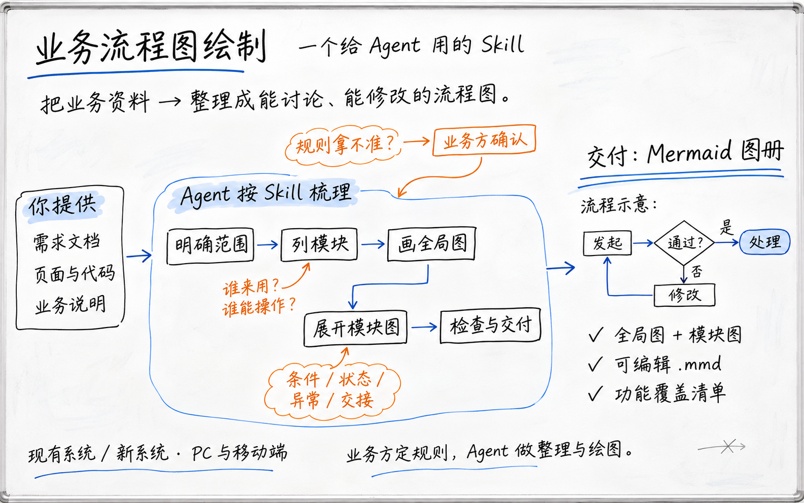
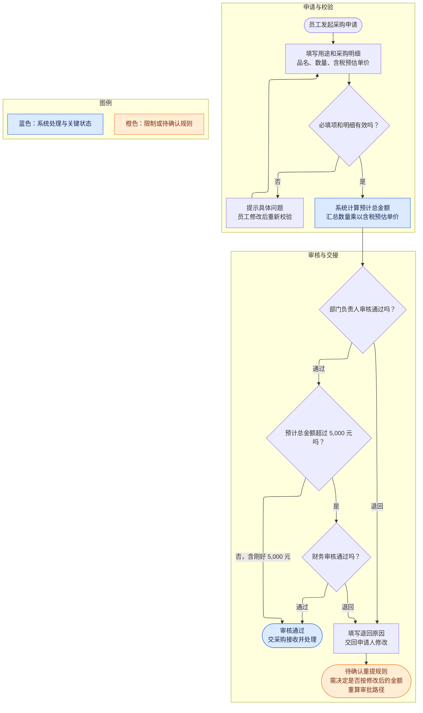

# Business Process Diagrams

**简体中文** | [English](README.en.md)

**业务流程图绘制**

[查看 Skill](skills/business-process-diagrams/SKILL.md) · [制图规范](skills/business-process-diagrams/references/mermaid-standard.md)



*技能工作方式示意图，由 AI 生成。*

让 Agent 从产品经理的角度，把业务说明、需求文档和系统资料整理成 Mermaid 流程图册。

先确定业务模块，再画全局流程，随后展开每个模块的完整流程。图中写清谁来处理、系统怎样判断、状态怎么变化，以及异常之后交给谁。

适用于 PC 端和移动端的业务流程梳理，也适用于新系统的产品设计。

## 为什么做这个技能

评审业务时，经常会遇到一些具体问题：审批通过之后谁下发资源？员工退出项目后哪些权限要收回？一次操作只成功了一部分，剩下的交给谁处理？

这些问题会影响产品需求、权限设计和验收。画图的过程可以帮助团队把它们提前讨论清楚，也方便顺着流程检查遗漏。

这个 Skill 把这套工作方式写成了可复用的指令。Agent 负责阅读材料、组织图册、绘图和校对，业务方负责决定材料中尚未确定的规则。

## 适合哪些工作

| 工作场景 | 处理方式 |
| --- | --- |
| 梳理现有系统 | 根据可访问的页面、实际操作、代码、文档和业务说明，还原功能、规则及运行边界 |
| 从 0 到 1 设计新系统 | 围绕目标用户、场景、角色和本期范围讨论方案，逐步形成目标流程 |
| 现有系统增加功能 | 分别标明已有流程和新增设计，检查新功能影响的模块与交接 |
| PRD 评审与业务交接 | 对照模块和子功能检查权限、判断、状态、异常及上下游结果 |
| PC 与移动端协作 | 在有依据的地方说明不同端的入口、职责和处理结果 |

如果材料只说明了 PC 端，移动端的能力会保留为待确认；演示页面、未接通功能和已实现功能也会分别标注。

## 会交付什么

一套图册通常包含：

- 模块目录和功能覆盖清单。
- 一张全局业务流程图，说明主线和跨模块交接。
- 每个业务模块一张完整功能流程图，按内部功能区域分组。
- 可编辑的 `.mmd` 源文件和图册导航。
- 有云端保存条件时，提供 Mermaid Chart 图册入口。
- 待业务决定、待补证据和待技术验证的事项。

具体图数由业务范围决定。同一模块中的独立功能从选择分支展开，保持各自的入口与结果；审批、维护、查询等操作不会被误画成人人必须依次执行的一条路径。

## 它怎样开展工作

业务材料 → 确定任务类型与范围 → 模块目录 → 全局图 → 模块图 → 逐图检查 → 保存与回读

梳理现有系统时，Agent 会记录每项判断的依据，并区分当前事实和优化建议。新系统设计中尚未决定的规则会明确标注，讨论结果会同步修订到受影响的图和覆盖清单。

每轮只集中讨论少量会改变流程的问题。已经提供的信息会继续沿用；常规整理与制图由 Agent 自主完成。

## 一个简单例子

以下是用于说明画法的虚构采购场景，规则不适用于其他项目。

已给材料：员工填写用途和采购明细；部门负责人审核；超过 5,000 元还需要财务审核；退回必须填写原因；通过后交采购处理。材料尚未说明退回后重新提交是否需要重新计算审批路径。

一个模块里的流程可以这样表达：



这里保留了金额边界、退回原因、接收角色和未决定的重提规则。实际图册还会依据完整材料补充权限、字段、状态、异常和其他适用分支。

示例用于解释表达方式；渲染器对 ELK 等配置的支持，仍需在实际展示环境检查。

## 快速开始

准备一个能读取本地 Skill 的 Agent。处理页面或代码时，还需要相应的访问工具和权限；保存到 Mermaid Chart 时，需要已连接的 Mermaid MCP 和目标位置的写入权限。

导入本仓库 `skills/business-process-diagrams/` 下的完整文件夹，保留 `SKILL.md`、`references/` 和随附的 Agent 配置。技能的加载、触发及重新加载方式，以所用 Agent 的说明为准。

也可以把下面的内容发给能读取 GitHub 仓库的 Agent：

```text
帮我安装这个 Skill：
https://github.com/nicoleyang959/business-process-diagrams/tree/main/skills/business-process-diagrams

先检查技能内容和当前 Agent 的加载方式，保留完整技能目录。
如果已有同名 Skill，先检查差异，保留我的修改。
安装后说明实际检查结果，以及是否需要重新加载技能。
```

云端保存位置由使用者指定。首次绘图时说明组织、项目和文件夹，Agent 会沿用本次会话已确认的位置。

### 梳理现有系统

```text
使用 business-process-diagrams 梳理这个现有系统。

项目名称：设备借用管理。
本次范围：申请、审核、发放、归还和异常处理，覆盖 PC 与移动端。
材料：附件中的需求说明，以及我提供的可访问页面和代码。

先整理模块目录，再画全局图和各模块完整流程图。
把已实现、演示、未接通、待验证的内容标清楚，优化建议另行说明。
每轮只问会影响流程的关键问题，其余整理和制图自主完成。
```

### 设计新系统

```text
使用 business-process-diagrams，和我一起设计一个新的设备借用系统。

目标：让员工能申请设备，管理员能核对库存、发放并追踪归还。
用户：员工、部门负责人、设备管理员。
本期范围：借用与归还；其他业务后续讨论。

先结合我提供的材料明确模块目录和关键规则，再绘制全局与模块图。
只问必须由我决定的问题；没有依据的规则标为待确认。
```

### 保存或更新云端图册

在绘图任务中补充：

```text
通过 Mermaid MCP 保存到我指定的组织和项目，集中放入“设备借用业务流程”文件夹。
已有对应图时原位更新并保留链接。
交付图册目录、可编辑源文件和功能覆盖清单，并说明逐图验证结果。
```

如果本轮只需要本地源文件，也可以直接说明。

## 图里会检查哪些内容

检查范围随业务材料确定，常见项目包括：

| 检查对象 | 需要讲清的内容 |
| --- | --- |
| 角色和权限 | 谁能查看或操作，能看哪些字段及哪些范围的数据 |
| 输入与规则 | 填什么、怎样校验、如何计算、条件边界是什么 |
| 状态变化 | 操作前后分别是什么状态，满足什么条件才能转换 |
| 异常和回退 | 失败、退回、撤回、重复提交、并发冲突或部分成功后怎样继续处理 |
| 跨模块交接 | 交什么对象、何时触发、由谁接收、处理后产生什么结果 |
| 保存与版本 | 保存是否成功，修改怎样影响版本、在途流程和历史记录 |

材料没有涉及的机制会按实际情况标为待确认或不适用，不为填满检查表而增加功能。

## 制图与核验

默认使用 `flowchart TB`、ELK 布局、default 主题、basis 连线，节点间距为 50，层级间距为 70。模块内部用 `subgraph` 分区，矩形表示操作，菱形表示判断，圆角表示起止和关键状态。

蓝色表示系统处理或关键状态；橙色表示限制或待确认事项；灰色用于演示、未闭环或后续阶段内容。每张图会用图例和文字说明具体含义。

交付时分别记录以下结果：

| 核验内容 | 核验依据 |
| --- | --- |
| 业务覆盖和流程设计 | 原始材料、模块目录、功能覆盖清单和逐分支检查 |
| Mermaid 语法与实际渲染 | 解析结果，以及实际生成的节点、文字和连线 |
| 云端保存结果 | 回读后的正文、标题、项目与文件夹归属 |
| 导航行为 | 实际点击后的目标；未验证时提供目录链接并标明状态 |

流程图描述的是有依据的现状或目标设计。线上操作是否生效，需要真实系统的操作与回读证据；保存成功、图形正常显示和业务实际完成分别记录。

## 当前范围

这个版本提供 Skill 指令和 Mermaid 制图规范。页面设计、代码开发和部署由后续任务另行开展。

Agent、Mermaid Chart 及 MCP 的可用能力和费用取决于使用环境与账户。缺少页面权限、云端操作或渲染能力时，交付中会说明受影响的核验项目。

向云端保存流程图前，应确认业务内容可以存放到目标组织。对外展示可使用虚构或脱敏的例子；真实业务材料和访问凭据按各自权限管理。
